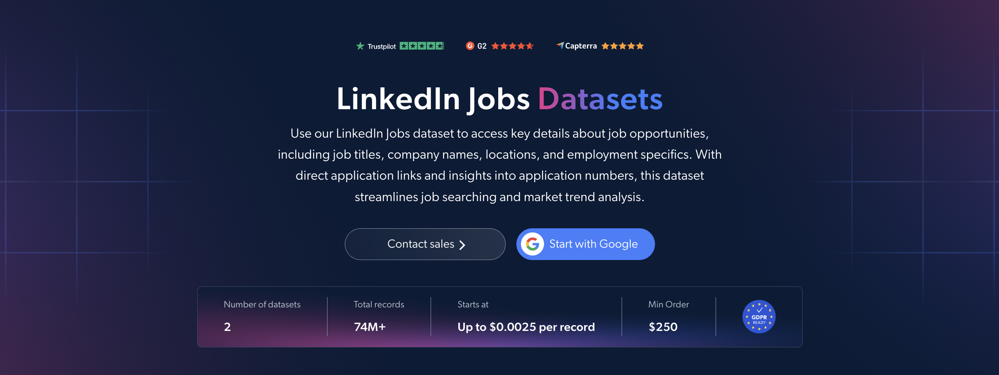

# LinkedIn-Jobs-dataset-samples

<h2>A sample dataset of 1000 LinkedIn job listings</h2>

<a href="https://brightdata.com/products/datasets/linkedin/jobs">
   
</a>

A LinkedIn jobs dataset sample of 1000 public job listings. Dataset was extracted using the <b>Bright Data API</b>.

<h2>Some of the data points that are included in the dataset:</h2>

* ```url```: URL of the job posting on LinkedIn
* ```job_posting_id```: Unique identifier for each job listing
* ```job_title```: Title of the advertised position
* ```company_name```: Name of the hiring company
* ```company_id```: Unique identifier for the hiring company
* ```company_url```: URL of the company's LinkedIn profile
* ```company_logo```: Logo of the hiring company
* ```job_location```: Geographic location of the job
* ```country_code```: Two-letter country code
* ```job_summary```: Overview of the role and its responsibilities
* ```job_description_formatted```: Formatted job description as displayed on LinkedIn
* ```job_seniority_level```: Seniority level of the position
* ```job_employment_type```: Employment type, such as full-time or part-time
* ```job_industries```: Industries associated with the job
* ```job_base_pay_range```: Advertised salary range
* ```base_salary```: Structured base salary range, including currency and pay period
* ```salary_standards```: Employer-provided pay standards or notes
* ```job_posted_date```: Date the job was posted
* ```job_num_applicants```: Applicant count shown for the job
* ```apply_link```: Link to apply for the position
* ```application_availability```: Whether applications are still accepted
* ```is_easy_apply```: Whether LinkedIn Easy Apply is available

And a lot more.

This is a sample subset which is derived from the "LinkedIn Job Listings Information (public data)"
dataset which includes more than <b>19,700,000 job listings</b>.

Available dataset file formats: <b>JSON, NDJSON, JSON Lines, CSV, or Parquet. Optionally, files can be compressed to .gz</b>.

Dataset delivery type options: <b>Email, API download, Webhook, Amazon S3, Google Cloud storage, Google Cloud PubSub, Microsoft Azure, Snowflake, SFTP</b>.

Update frequency: <b>Once, Daily, Weekly, Monthly, Quarterly, Biannual, or Custom basis</b>.

Data enrichment available as an addition to the data points extracted: <b>Based on request.</b>

<b>[Get the full LinkedIn Jobs dataset](https://brightdata.com/products/datasets/linkedin/jobs)</b>.

<a href="https://brightdata.com/products/datasets/linkedin/jobs">
</a>

<h2>What are the LinkedIn Jobs datasets use cases?</h2>

<h3>1. Employment trends and labor market research</h3>
Researchers and business analysts use LinkedIn jobs datasets to study hiring activity across industries, locations and seniority levels. Analyzing job titles, descriptions and posting dates helps identify in-demand skills and emerging roles, while recurring updates reveal changes in hiring patterns over time.

<h3>2. Salary benchmarking and competitor analysis</h3>
HR teams compare advertised salary ranges, employment types and job requirements across competing employers. Grouping comparable roles by location and seniority supports compensation benchmarking and helps companies refine their hiring strategies.

<h3>3. Recruitment and workforce planning</h3>
Recruiters analyze job descriptions, applicant counts and application availability to understand requirements and applicant interest across roles. These insights help teams refine job listings, prioritize recruitment efforts and plan future workforce needs.

<h2>Free access to web scraping tools and datasets for academic researchers and NGOs</h2>

The Bright Initiative offers access to Bright Data's <b>[Web Scraper APIs](https://brightdata.com/products/web-scraper)</b> and <b>[ready-to-use datasets](https://brightdata.com/products/datasets)</b> to leading academic faculties and researchers, NGOs and NPOs promoting various environmental and social causes. You can submit an application <b>[here](https://brightinitiative.com)</b>.
